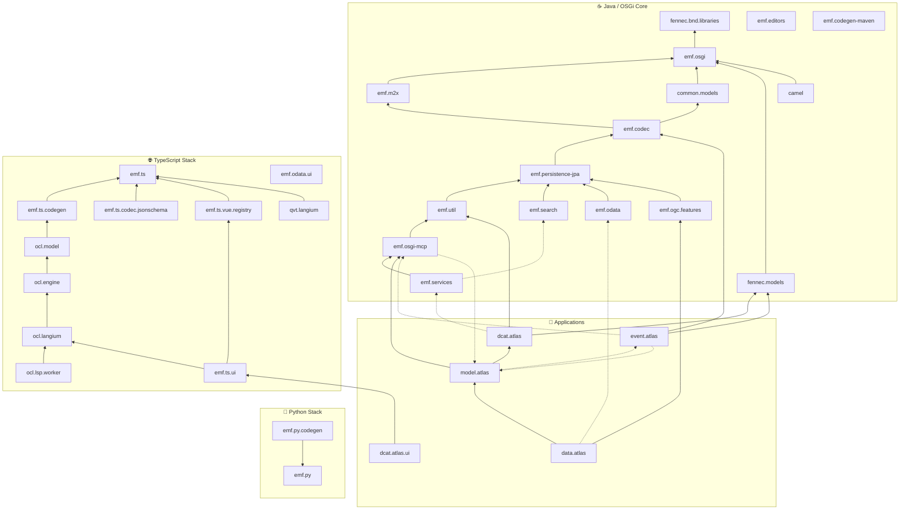

# Eclipse Fennec

**EMF for OSGi and the Web**

Turning the Eclipse Modeling Framework into first-class OSGi services —
and bringing a full EMF/OCL stack to the web.

[📖 Documentation](https://eclipse-fennec.github.io/) ·
[🦊 Eclipse Project](https://projects.eclipse.org/projects/modeling.fennec)

---

## About

Eclipse Fennec extends [EMF](https://eclipse.dev/modeling/emf/) to work
optimally with OSGi and adds the components needed for end-to-end, model-based
applications — serialization and codecs, distributed model registries,
persistence and validation. The work spans a ready-to-run application, a
Java/OSGi core, and a TypeScript stack that brings EMF and OCL to the browser.

## Projects

### 🚀 Applications

| Project | Description |
| --- | --- |
| [model.atlas](https://github.com/eclipse-fennec/model.atlas) | Fennec Model Atlas — a distributed EMF model registry and repository service. |
| [data.atlas](https://github.com/eclipse-fennec/data.atlas) | Fennec Data Atlas — data management service built on the Fennec stack. |
| [dcat.atlas](https://github.com/eclipse-fennec/dcat.atlas) | Fennec DCAT-AP open data portal. |
| [event.atlas](https://github.com/eclipse-fennec/event.atlas) | Fennec Event Atlas — EMF extension for the Eclipse sensiNact broker. |
| [dcat.atlas.ui](https://github.com/eclipse-fennec/dcat.atlas.ui) | Vue-based web UI for the Fennec DCAT Atlas. |

### ☕ Java / OSGi Core

| Project | Description |
| --- | --- |
| [emf.osgi](https://github.com/eclipse-fennec/emf.osgi) | OSGi extension for EMF — dynamic model and package registries. |
| [emf.util](https://github.com/eclipse-fennec/emf.util) | Utilities and commons for Fennec EMF OSGi. |
| [emf.codec](https://github.com/eclipse-fennec/emf.codec) | Jackson 3 based EMF serializer / de-serializer. |
| [emf.odata](https://github.com/eclipse-fennec/emf.odata) | OData protocol support for EMF models. |
| [emf.ogc.features](https://github.com/eclipse-fennec/emf.ogc.features) | OGC API – Features implementation based on EMF. |
| [emf.services](https://github.com/eclipse-fennec/emf.services) | EMF-based, OSGi-inspired distributed service registry framework. |
| [emf.m2x](https://github.com/eclipse-fennec/emf.m2x) | EMF validation, transformation and generation. |
| [emf.persistence-jpa](https://github.com/eclipse-fennec/emf.persistence-jpa) | EMF JPA-like persistence using EclipseLink. |
| [emf.search](https://github.com/eclipse-fennec/emf.search) | Lucene index extension for EMF. |
| [emf.editors](https://github.com/eclipse-fennec/emf.editors) | Custom EMF Eclipse editors. |
| [emf.codegen-maven](https://github.com/eclipse-fennec/emf.codegen-maven) | Maven code generation for EMF OSGi. |
| [emf.osgi-mcp](https://github.com/eclipse-fennec/emf.osgi-mcp) | MCP OSGi whiteboard using EMF models as structured output. |
| [common.models](https://github.com/eclipse-fennec/common.models) | Common EMF models (Ecore models). |
| [fennec.models](https://github.com/eclipse-fennec/fennec.models) | Fennec-specific EMF models (e.g. compliance models). |
| [camel](https://github.com/eclipse-fennec/camel) | EMF Apache Camel whiteboard integration. |
| [fennec.bnd.libraries](https://github.com/eclipse-fennec/fennec.bnd.libraries) | Fennec workspace and project libraries. |

### 🌐 TypeScript Stack

| Project | Description |
| --- | --- |
| [emf.ts](https://github.com/eclipse-fennec/emf.ts) | TypeScript based EMF. |
| [emf.ts.codegen](https://github.com/eclipse-fennec/emf.ts.codegen) | TypeScript based EMF code generation. |
| [emf.ts.codec.jsonschema](https://github.com/eclipse-fennec/emf.ts.codec.jsonschema) | TypeScript based EMF codec for JSON Schema. |
| [emf.ts.vue.registry](https://github.com/eclipse-fennec/emf.ts.vue.registry) | Vue-based registry for TypeScript EMF. |
| [emf.ts.ui](https://github.com/eclipse-fennec/emf.ts.ui) | UI model composer and editor packages for TypeScript EMF. |
| [emf.odata.ui](https://github.com/eclipse-fennec/emf.odata.ui) | TypeScript OData UI. |
| [qvt.langium](https://github.com/eclipse-fennec/qvt.langium) | QVT grammar and language server built with Langium. |
| [ocl.engine](https://github.com/eclipse-fennec/ocl.engine) | Object Constraint Language evaluation engine. |
| [ocl.langium](https://github.com/eclipse-fennec/ocl.langium) | OCL grammar built with Langium. |
| [ocl.lsp.worker](https://github.com/eclipse-fennec/ocl.lsp.worker) | OCL Langium language-server worker. |
| [ocl.model](https://github.com/eclipse-fennec/ocl.model) | OCL model definitions. |

### 🐍 Python Stack

| Project | Description |
| --- | --- |
| [emf.py](https://github.com/eclipse-fennec/emf.py) | EMF implementation for Python. |
| [emf.py.codegen](https://github.com/eclipse-fennec/emf.py.codegen) | EMF code generation for Python. |

## Dependency Graph

How the projects build on each other. Solid arrows are build-time dependencies
(bnd `-library` / `-buildpath`, npm and Python packages), shown as a transitive
reduction — an arrow is omitted when the dependency is already implied by
another path. Dotted arrows are runtime-only dependencies (launch / Docker
`.bndrun` assemblies). All Java projects ultimately build on `emf.osgi` and
`fennec.bnd.libraries`.

## Documentation

The central documentation hub lives at
**[eclipse-fennec.github.io](https://eclipse-fennec.github.io/)** — start there
for the project overview and links into each repository.

## Contributing

Contributions are welcome! Eclipse Fennec is an
[Eclipse Foundation](https://www.eclipse.org/) project, so a few formalities
apply:

- Sign the [Eclipse Contributor Agreement (ECA)](https://www.eclipse.org/legal/eca/).
- Sign off every commit per the [Developer Certificate of Origin](https://www.eclipse.org/legal/dco/) (`git commit -s`).
- Use the matching email address on your commits and your Eclipse account.

## Security

See [SECURITY.md](https://github.com/eclipse-fennec/.github/blob/main/SECURITY.md)
for how to report a vulnerability through the Eclipse Foundation's coordinated
disclosure process.

## License

Released under the [Eclipse Public License 2.0](https://www.eclipse.org/legal/epl-2.0/).
